  

  
  
  
  

 

### *the edit*

Software engineer by day, founder by night. I build things that are useful **and** beautiful: tools, brands and websites that sit between the U.S. and Europe. Romanian roots, French heart, Arizona sun.

Most of my code lives in private repos. This page is the window display.

### *now showing*

| | venture | what it is | stage |
|:-:|:--|:--|:--|
| ✦ | **[Forecraft](https://forecraft.tech)** | financial readiness & close scoring for advisors and finance teams | `piloting` |
| ✦ | **Studio Clar** | AI automation & implementation for Romanian businesses | `early` |
| ✦ | **[Octavia Studios](https://instagram.com/octaviastudiosss)** | Romania × Côte d'Azur lifestyle brand | `growing` |
| ✦ | **[anabadulescu.com](https://anabadulescu.com)** | my editorial home on the internet | `live` |
| ✦ | **Debits & Coffee** | brand & content for my mom's accounting venture | `supporting` |

### *the toolkit*

  
  
  
  
  
  
  
  

### *notes in the margin*

- 🌍 English · Română · Français
- ☕ currently obsessed with motion design, editorial type and slow mornings
- 📮 collaborations, ideas, or just *bonjour*: [hello@anabadulescu.com](mailto:hello@anabadulescu.com)

<i>A ✦ B — designed with the same hand as <a href="https://anabadulescu.com">anabadulescu.com</a></i>

